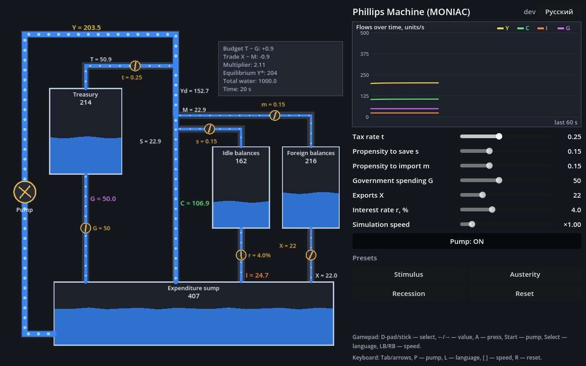
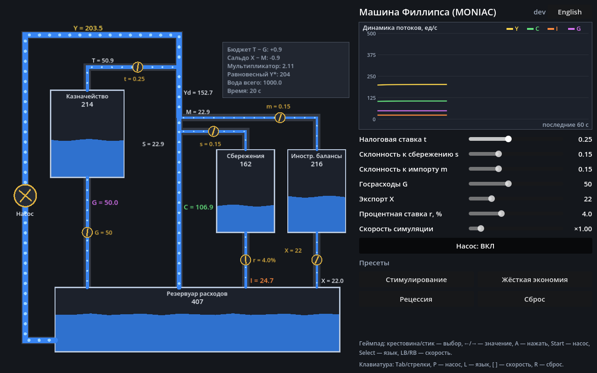

# Phillips Machine (MONIAC)

[English](#english) · [Русский](#русский)

## English

A Godot 4.7 simulation of the **Phillips Machine (MONIAC)**, the hydraulic computer Bill Phillips built in
1949 to model the national economy. Money is water: it is pumped up as national income, drains off into
taxes, savings and imports, and flows back as government spending, investment and exports.



**Download (Windows):** the latest build is on the [Releases](https://github.com/avv123avv/phillips_machine/releases/latest)
page. Unpack the zip and run `PhillipsMachine.exe`. Every merge into `main` publishes a new version automatically.

**Run from source:** Godot 4.7 → Import → select `project.godot` → F5. The screen is 1280×800 (Steam Deck),
GL Compatibility renderer. The UI language follows the system on first launch; switch it with the
**English / Русский** button, **L** or the gamepad **Select** button.

### Model

Four tanks hold all the water (1000 units, conserved exactly):

| Tank | Inflow | Outflow |
|---|---|---|
| Expenditure sump | C, G, I, X | the pump: **Y = 0.5 · level** |
| Treasury | T = t·Y | G (government spending valve) |
| Idle balances | S = s·Yd | I = 45·e^(−0.15·r) |
| Foreign balances | M = m·Yd | X (exports valve) |

Yd = Y − T, and consumption C = Yd − S − M goes straight back to the sump. An outflow is choked when its
tank runs nearly dry, so a budget deficit cannot last forever: once the Treasury is empty, G falls to T.
If no tank is empty, Y settles at the multiplier equilibrium
**Y\* = (G + I + X) / (1 − (1 − t)(1 − s − m))**, shown on screen together with the budget (T − G) and the
trade balance (X − M).

### Controls

| Gamepad | Keyboard | Action |
|---|---|---|
| D-pad / left stick | arrows, Tab | move between controls |
| ← / → on a slider | ← / → | change the value |
| A | Enter / Space | press a button |
| Start | P | pump on / off |
| Select | L | language |
| LB / RB | [ / ] | simulation speed ÷2 / ×2 |
| — | R | reset |

Sliders: tax rate t, propensity to save s, propensity to import m, government spending G, exports X,
interest rate r, simulation speed. Presets: **Stimulus** (lower taxes, higher G, cheap money),
**Austerity** (higher taxes, lower G), **Recession** (households save more, high r, exports collapse),
**Reset**.

### Tests

```
godot --headless --path . --import
godot --headless --path . -s tests/run_tests.gd
```

CI runs them on every push and PR, and builds a Windows exe.

## Русский

Симуляция **машины Филлипса (MONIAC)** на Godot 4.7. Это гидравлический компьютер, который Билл Филлипс
построил в 1949 году как модель национальной экономики. Деньги здесь — вода: насос поднимает её наверх как
национальный доход, часть уходит в налоги, сбережения и импорт, а назад возвращается госрасходами,
инвестициями и экспортом.



**Скачать (Windows):** последняя сборка — на странице [Releases](https://github.com/avv123avv/phillips_machine/releases/latest).
Распакуйте zip и запустите `PhillipsMachine.exe`. Каждое слияние в `main` автоматически выпускает новую версию.

**Запуск из исходников:** Godot 4.7 → Import → выбрать `project.godot` → F5. Экран 1280×800 (Steam Deck),
рендерер GL Compatibility. Язык при первом запуске — как в системе; переключение кнопкой
**English / Русский**, клавишей **L** или кнопкой **Select** на геймпаде.

### Модель

Вся вода (1000 единиц, сохраняется точно) распределена по четырём резервуарам:

| Резервуар | Приток | Отток |
|---|---|---|
| Резервуар расходов (sump) | C, G, I, X | насос: **Y = 0,5 · уровень** |
| Казначейство | T = t·Y | G (клапан госрасходов) |
| Сбережения (idle balances) | S = s·Yd | I = 45·e^(−0,15·r) |
| Иностранные балансы | M = m·Yd | X (клапан экспорта) |

Yd = Y − T, потребление C = Yd − S − M сразу возвращается в нижний резервуар. Когда бак почти пуст, его
отток пережимается, поэтому бюджетный дефицит не вечен: пустое казначейство не может платить больше, чем
собирает налогов. Пока ни один бак не пуст, Y приходит к равновесию мультипликатора
**Y\* = (G + I + X) / (1 − (1 − t)(1 − s − m))**; оно показано на экране вместе с бюджетом (T − G)
и торговым сальдо (X − M).

### Управление

| Геймпад | Клавиатура | Действие |
|---|---|---|
| крестовина / левый стик | стрелки, Tab | переход между элементами |
| ← / → на слайдере | ← / → | изменить значение |
| A | Enter / Пробел | нажать кнопку |
| Start | P | насос вкл / выкл |
| Select | L | язык |
| LB / RB | [ / ] | скорость симуляции ÷2 / ×2 |
| — | R | сброс |

Слайдеры: налоговая ставка t, склонность к сбережению s, склонность к импорту m, госрасходы G, экспорт X,
процентная ставка r, скорость симуляции. Пресеты: **Стимулирование** (ниже налоги, выше G, дешёвые деньги),
**Жёсткая экономия** (выше налоги, ниже G), **Рецессия** (домохозяйства больше копят, высокая ставка, обвал
экспорта), **Сброс**.

### Тесты

```
godot --headless --path . --import
godot --headless --path . -s tests/run_tests.gd
```

CI запускает их на каждый push и PR и собирает exe для Windows.
